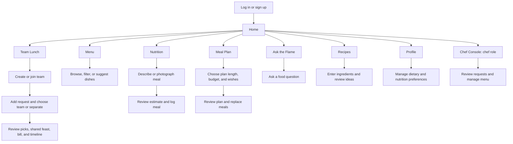
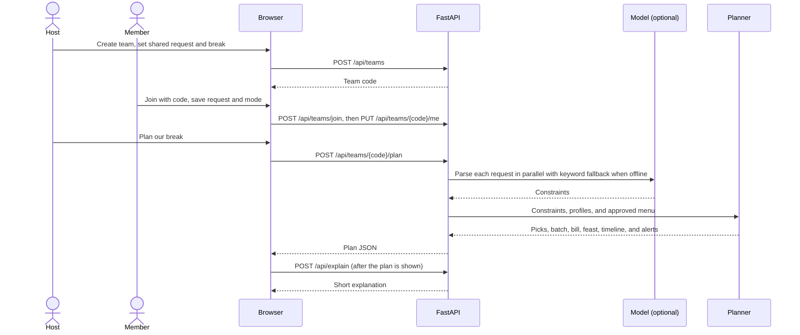
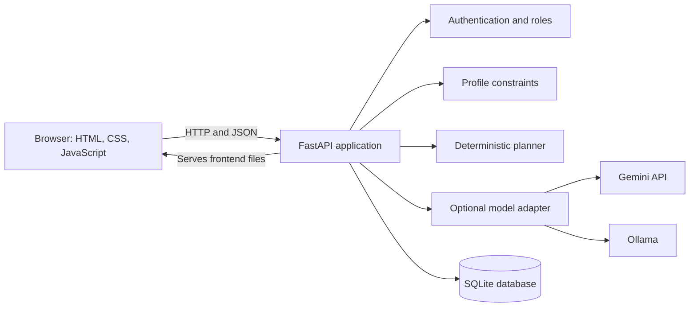

# Flame-n-Focus

Flame-n-Focus is a team lunch-planning and food wellness application. It combines individual food requests into a practical group order, estimates cost and timing, and provides tools for menu browsing, nutrition logging, meal planning, food questions, and recipes.

Built at Hacktoberfest Hack Day Lahore. Licensed under Apache-2.0. The bundled menu contains fictional demo data and does not represent a real restaurant.

## Live demo

[Watch the Flame-n-Focus demo](https://drive.google.com/file/d/1NTnBKhftZ3hy02JoCOy70b5QyQNgcefj/view?usp=sharing)

## Product design

[Open the published Flame-n-Focus UI design in Figma](https://www.figma.com/design/QLzjU0EbcApWHn8bfRVWvv/FoodZero-Restaurant-and-Food-for-Figma-Web-Template--Community-?node-id=0-1&p=f&t=Od9LJVB286DzxFEU-0)

## User experience

Users sign in or create an account, then arrive at Home. The app's primary pages are available from the navigation. Home summarizes teams and nutrition activity; the Chef Console is available only to chef accounts.



| Page | Primary user task |
| --- | --- |
| Login / Sign up | Sign in or create a member account. New accounts cannot assign themselves the chef role. |
| Home | Review teams and nutrition activity; navigate to the app's main tasks. |
| Team Lunch | Create or join a team, submit a request, choose team or separate mode, and review orders, cost, and timing. |
| Menu | Search and filter dishes or suggest an off-menu dish. Chef accounts can manage menu entries and scan a menu image. |
| Nutrition | Analyze a meal, review estimated nutrition, log it, and view recent progress. |
| Meal Plan | Generate a 1-, 3-, or 7-day plan with optional wishes and budget; replace meals as needed. |
| Ask the Flame | Ask food and nutrition questions in a chat. |
| Recipes | Request recipe ideas from available ingredients. |
| Profile | Manage diet, allergies, nutrition goals, optional health notes, voice-input language, and account deletion. |
| Chef Console | Review dish requests, edit menu items, and import scanned menu drafts. |

## Team lunch workflow

1. A host creates a team, sets the shared request and break time, then shares the six-character team code.
2. Members join and save individual requests. **With the team** combines the member's request with the shared request; **Separately** ignores the shared request. Profile diet preferences and recognized allergies apply in either mode.
3. The app parses requests into constraints using the configured AI model or a basic keyword and number parser when offline.
4. The Python planner filters out menu items that violate hard constraints and scores eligible items using stated likes, price, and a preference for batching the same dishes.
5. The API returns individual picks, kitchen batch quantities, a bill split, a shared-feast option, a break timeline, and anonymous severe-allergen alerts. Users can compare options and copy a summary to share.

The planner, not the language model, chooses the final dishes and calculates the bill and timeline. Team plans are computed when requested and are not stored as a history.



## Architecture



The browser frontend is plain HTML, CSS, and JavaScript with no build step. FastAPI serves the frontend and the `/api/...` endpoints. `server.py` validates requests, applies authentication and role checks, reads and writes data, and calls the feature modules.

| Component | Responsibility |
| --- | --- |
| `server.py` | HTTP routes, request validation, authorization, and feature orchestration. |
| `flame/auth.py` | Password hashing, bearer-token sessions, and chef authorization. |
| `flame/db.py` | SQLite schema and connections; loads the sample menu when the menu table is empty. |
| `flame/profile.py` | Converts saved diet and allergy settings into planning constraints. |
| `flame/planner.py` | Filters and scores menu items; computes orders, batches, bill splits, feasts, timelines, and alerts. |
| `flame/llm.py` | Gemini/Ollama integration, structured model tasks, and preference parsing fallback. |
| `web/` | Browser shell, styles, navigation, and page views. |
| `data/sample_menu.json` | Fictional starter menu. |
| `skills/group-lunch-planner/SKILL.md` | Agent Skill describing the group-lunch workflow. |

### Request and data flow

For a signed-in request, the browser sends an HTTP request to FastAPI with a bearer session token. FastAPI validates the request and user access, loads the relevant menu/profile/team data from SQLite, and calls the planner or model adapter as needed. The resulting JSON is returned to the page and rendered in the browser.

The default database path is `data/flame.db`; set `FLAME_DB` to use a different SQLite file. Accounts, profiles, menus, team memberships and requests, food logs, and each user's latest meal plan are stored. Meal plans are persisted per user; team lunch results are generated on demand and are not persisted.

## AI configuration and availability

The default Gemini model is Gemma 4 (`gemma-4-26b-a4b-it`). When `GEMINI_API_KEY` is set, the app uses Gemini. Otherwise, it uses Ollama when `OLLAMA_MODEL` is set. Optional settings are `GEMMA_MODEL` (Gemini model), `OLLAMA_URL` (Ollama server address), and `GEMMA_THINKING` (Gemini thinking level; defaults to `minimal`).

| Capability | With a model | Without a model |
| --- | --- | --- |
| Team preference parsing | Model parsing with rule-based completion/fallback. | Basic keyword and number parsing. |
| Order selection, bill, and timeline | Deterministic Python planner. | Deterministic Python planner. |
| Meal plans, chat, recipes, menu-photo scanning | Available. | Requires a model. |
| Nutrition analysis | Text or image-based estimates. | Text can only match known menu dishes; image analysis is unavailable. |
| Custom dish suggestion | Attempts AI price and nutrition estimates. | Adds the dish with default estimates and marks them accordingly. |

## Local development

Requires Python 3.10 or newer.

```bash
python -m venv .venv
source .venv/bin/activate
pip install -r requirements.txt
uvicorn server:app --reload --port 8000
```

Open [http://localhost:8000](http://localhost:8000) and create an account. To enable Gemini, create a local `.env` file in the project root containing your own key:

```dotenv
GEMINI_API_KEY=your_api_key
```

Alternatively, install Ollama, download a compatible model, and set `OLLAMA_MODEL` in `.env`. Do not commit API keys or other credentials.

## Security, privacy, and limitations

- Passwords are hashed with scrypt. Bearer sessions expire after 14 days.
- Authenticated users can access their own private data and teams they belong to. Chef-only operations are authorized on the server.
- Self-service registration always creates a member account. Chef accounts must be provisioned by an operator.
- Health profile details are not included in team member data. Individual health cautions, when generated, are returned only to the person they concern. Severe team allergen alerts do not identify the person with the allergy.
- Account deletion removes related profile, session, food log, and meal plan records.
- Nutrition values, health cautions, model estimates, and menu allergen data may be inaccurate. This application is for general wellness information and is not medical advice or a medical product.
